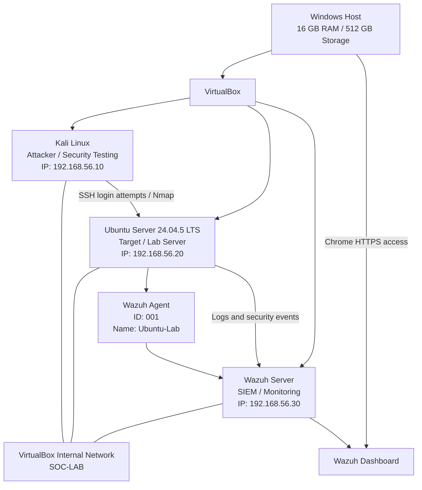
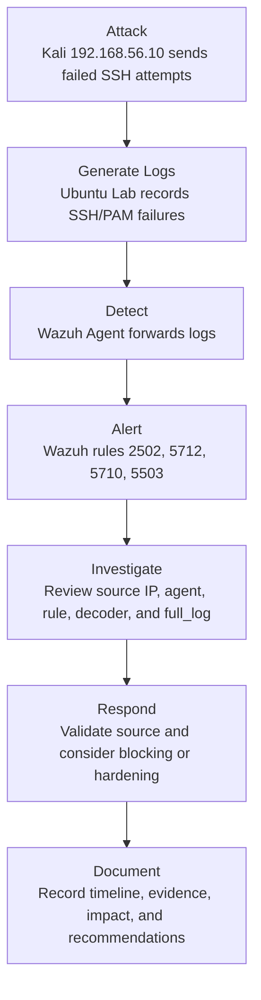

# Mini SOC + Attack Lab

A beginner-friendly cybersecurity home lab demonstrating Linux administration, attack simulation, log collection, detection engineering, and SOC investigation using Kali Linux, Ubuntu Server, and Wazuh.

---

## 1. Overview

This project is a self-contained **Mini SOC + Attack Lab** built with VirtualBox on a Windows host.

The lab simulates a small security monitoring environment where:

* Kali Linux acts as the attacker and security-testing machine.
* Ubuntu Lab acts as the target Linux server.
* Wazuh acts as the SIEM and security monitoring platform.
* Security events are generated, logged, detected, investigated, and documented.

The main workflow is:

```text
Attack → Generate Logs → Detect → Investigate → Respond → Document
```

The project is designed to demonstrate practical beginner-level skills relevant to:

* SOC Analyst roles
* Linux Administrator roles
* Cybersecurity fresher roles
* Security monitoring and incident investigation
* Network reconnaissance and traffic analysis
* Detection engineering using Sigma

This is a learning lab, not a production security environment.

---

## 2. About the Builder

I am **Vikas Gurjar**, a Computer Science and Engineering student from the 2023–2027 batch, targeting SOC Analyst, Linux Administrator, and Cybersecurity fresher opportunities.

My existing background includes Linux, Unix, C, Python, Assembly, Shell Scripting, Computer Networks, Operating Systems, Wireshark, Nmap, Burp Suite, pwn.college web and binary exploitation, and a custom Unix shell built in C using `fork()`, `execvp()`, `waitpid()`, pipes, I/O redirection, `dup2()`, and command history.

* GitHub: `[VERIFY: Add GitHub profile URL]`
* LinkedIn: `[VERIFY: Add LinkedIn profile URL]`

---

## 3. Lab Architecture

### Network topology

All three virtual machines communicate through a VirtualBox Internal Network named `SOC-LAB`.



### Lab components

| Machine             | Role                        |      IP address |
| ------------------- | --------------------------- | --------------: |
| Kali Linux `Bairan` | Attacker / security testing | `192.168.56.10` |
| Ubuntu Server `Lab` | Target Linux server         | `192.168.56.20` |
| Wazuh VM            | SIEM / monitoring server    | `192.168.56.30` |

### Additional Wazuh dashboard access network

A Host-only adapter was also configured for browser access from Windows:

```text
Wazuh Host-only IP: 192.168.57.10
```

`[VERIFY: Confirm whether the final dashboard access IP should be documented as 192.168.57.10 or another Host-only address.]`

The `SOC-LAB` address `192.168.56.30` is used for VM-to-VM communication.

---

## 4. Prerequisites

### Hardware

* Windows host
* 16 GB RAM
* 512 GB storage
* VirtualBox
* Sufficient free disk space for three virtual machines

### Virtual machines

* Kali Linux
* Ubuntu Server 24.04.5 LTS AMD64
* Ubuntu Server for Wazuh
* Wazuh all-in-one installation

### Recommended VM resources

| VM         | RAM used in the lab | Purpose                               |
| ---------- | ------------------: | ------------------------------------- |
| Kali Linux |  Approximately 3 GB | Attacker and network testing          |
| Ubuntu Lab |  Approximately 5 GB | Target server                         |
| Wazuh      |  Approximately 8 GB | Wazuh manager, indexer, and dashboard |

Because the host has 16 GB RAM, running all three VMs simultaneously may create memory pressure. Start only the VMs needed for the current task.

### Background knowledge

Helpful knowledge includes:

* Basic Linux terminal commands
* IP addresses and subnets
* SSH
* Linux users and permissions
* Basic networking
* HTTP
* Logs
* Virtual machines
* Basic cybersecurity concepts

---

# 5. Build Log

## Phase 1 — VirtualBox and Network Setup

### Objective

Create three VMs and allow them to communicate through the isolated `SOC-LAB` network.

### VirtualBox network configuration

Each VM used:

| Adapter   | Configuration                     | Purpose                           |
| --------- | --------------------------------- | --------------------------------- |
| Adapter 1 | NAT                               | Internet access                   |
| Adapter 2 | Internal Network: `SOC-LAB`       | VM-to-VM lab communication        |
| Adapter 3 | Host-only Adapter, used for Wazuh | Windows-to-Wazuh dashboard access |

The Internal Network name must be exactly:

```text
SOC-LAB
```

### Static IP plan

```text
Kali Linux:       192.168.56.10/24
Ubuntu Lab:       192.168.56.20/24
Wazuh Server:     192.168.56.30/24
```

### Ubuntu Lab static IP

Run on **Ubuntu Lab**:

```bash
sudo nmcli connection add type ethernet ifname enp0s8 con-name SOC-LAB ipv4.method manual ipv4.addresses 192.168.56.20/24
```

```bash
sudo nmcli connection up SOC-LAB
```

### Kali static IP

Run on **Kali Linux**:

```bash
sudo nmcli connection modify "Wired connection 1" ipv4.method manual ipv4.addresses 192.168.56.10/24 ipv4.never-default yes
```

```bash
sudo nmcli connection up "Wired connection 1"
```

### Wazuh temporary IP configuration

During initial setup, the Wazuh Internal Network interface was configured using:

```bash
sudo ip link set enp0s8 up
```

```bash
sudo ip addr add 192.168.56.30/24 dev enp0s8
```

### Wazuh permanent Netplan configuration

The Wazuh Netplan file was edited:

```bash
sudo nano /etc/netplan/50-cloud-init.yaml
```

The intended configuration was:

```yaml
network:
  version: 2
  ethernets:
    enp0s3:
      dhcp4: true

    enp0s8:
      addresses:
        - 192.168.56.30/24

    enp0s9:
      addresses:
        - 192.168.57.10/24
```

Apply the configuration on **Wazuh**:

```bash
sudo netplan apply
```

Verify:

```bash
ip -br a
```

Expected relevant output:

```text
enp0s8    UP    192.168.56.30/24
enp0s9    UP    192.168.57.10/24
```

`[VERIFY: Confirm the final persistent Netplan configuration and exact Host-only IP.]`

### Network verification

Run from **Kali**:

```bash
ping -c 3 192.168.56.20
```

```bash
ping -c 3 192.168.56.30
```

Run from **Ubuntu Lab**:

```bash
ping -c 3 192.168.56.10
```

```bash
ping -c 3 192.168.56.30
```

Run from **Wazuh**:

```bash
ping -c 3 192.168.56.10
```

```bash
ping -c 3 192.168.56.20
```

Internet verification:

```bash
ping -c 3 google.com
```

---

## Phase 2 — SSH Installation on Ubuntu Lab

### Objective

Enable SSH so the target server can be remotely accessed and monitored.

Run on **Ubuntu Lab**:

```bash
sudo apt update
```

```bash
sudo apt install openssh-server -y
```

```bash
sudo systemctl enable --now ssh
```

Verify:

```bash
sudo systemctl status ssh --no-pager
```

Expected:

```text
Active: active (running)
```

### SSH test from Kali

Run on **Kali**:

```bash
ssh kaal@192.168.56.20
```

This confirmed that Kali could remotely access Ubuntu Lab.

---

## Phase 3 — Apache Web Server

### Objective

Run a web service on Ubuntu Lab and create HTTP traffic for monitoring.

Run on **Ubuntu Lab**:

```bash
sudo apt update
```

```bash
sudo apt install apache2 -y
```

```bash
sudo systemctl enable --now apache2
```

Verify:

```bash
sudo systemctl status apache2 --no-pager
```

### Test Apache from Kali

Run on **Kali**:

```bash
curl http://192.168.56.20
```

### Apache log locations

On **Ubuntu Lab**:

```text
/var/log/apache2/access.log
/var/log/apache2/error.log
```

Inspect access logs:

```bash
sudo tail -n 20 /var/log/apache2/access.log
```

Inspect error logs:

```bash
sudo tail -n 20 /var/log/apache2/error.log
```

### Custom webpage

The Apache webpage was edited at:

```bash
sudo nano /var/www/html/index.html
```

`[VERIFY: Add the final HTML content or screenshot of the custom webpage.]`

---

## Phase 4 — Linux Users, Groups, and Permissions

### Objective

Practice Linux account management, group permissions, file ownership, and access control.

### Create a user

Run on **Ubuntu Lab**:

```bash
sudo adduser socanalyst
```

Verify:

```bash
id socanalyst
```

### Create a group

```bash
sudo groupadd socteam
```

### Add users to the group

```bash
sudo usermod -aG socteam socanalyst
```

```bash
sudo usermod -aG socteam kaal
```

### Create SOC evidence directory

```bash
sudo mkdir -p /opt/soc-lab
```

Create an incident log:

```bash
sudo nano /opt/soc-lab/incident.log
```

The file contained:

```text
[INFO] SOC lab started
[INFO] Monitoring SSH and Apache logs
[WARNING] Multiple failed SSH login attempts detected
[ALERT] Suspicious activity requires investigation
```

### Configure ownership and permissions

```bash
sudo chown kaal:socteam /opt/soc-lab/incident.log
```

```bash
sudo chmod 640 /opt/soc-lab/incident.log
```

Verify:

```bash
ls -l /opt/soc-lab/incident.log
```

Expected permission pattern:

```text
-rw-r-----
```

### Permission testing

Read the file as `socanalyst`:

```bash
sudo -u socanalyst cat /opt/soc-lab/incident.log
```

Attempt to append to the file:

```bash
sudo -u socanalyst bash -c 'echo "test" >> /opt/soc-lab/incident.log'
```

The append operation was expected to fail with a permission error because the file owner is `kaal` and the group has read-only access.

Check the last lines:

```bash
tail -n 5 /opt/soc-lab/incident.log
```

---

## Phase 5 — UFW Firewall

### Objective

Enable a host firewall while allowing required services.

Run on **Ubuntu Lab**:

```bash
sudo ufw allow 22/tcp
```

```bash
sudo ufw allow 80/tcp
```

```bash
sudo ufw enable
```

Verify:

```bash
sudo ufw status verbose
```

Expected allowed services:

```text
22/tcp
80/tcp
```

SSH and Apache were tested again from Kali after enabling UFW.

### Wazuh firewall troubleshooting

On the Wazuh VM, UFW was checked using:

```bash
sudo ufw status verbose
```

The result was:

```text
Status: inactive
```

Therefore, UFW was not the cause of the initial Windows dashboard connection timeout.

---

## Phase 6 — SSH Attack Simulation

### Objective

Generate realistic authentication-failure logs in the isolated lab.

Run on **Kali**:

```bash
ssh fakeuser@192.168.56.20
```

Enter an incorrect password several times.

After generating the events, stop the SSH command:

```text
Ctrl + C
```

### Investigate on Ubuntu Lab

Search for failed passwords:

```bash
sudo grep "Failed password" /var/log/auth.log | tail -n 10
```

Count failed-password events:

```bash
sudo grep -c "Failed password" /var/log/auth.log
```

Search for invalid users:

```bash
sudo grep -E "Failed password|Invalid user" /var/log/auth.log | tail -n 20
```

Inspect SSH service logs:

```bash
sudo journalctl -u ssh --since "30 minutes ago"
```

### Confirmed attacker and target

```text
Source / attacker: Kali Linux — 192.168.56.10
Target: Ubuntu Lab — 192.168.56.20
```

---

## Phase 7 — Evidence Collection

### Objective

Save investigation data in a structured directory.

Run on **Ubuntu Lab**:

```bash
mkdir -p ~/soc-evidence
```

Save running services:

```bash
systemctl --type=service --state=running > ~/soc-evidence/running-services.txt
```

Save SSH failures:

```bash
sudo grep -E "Failed password|Invalid user" /var/log/auth.log > ~/soc-evidence/ssh-failures.txt
```

Save Apache access logs:

```bash
sudo tail -n 50 /var/log/apache2/access.log > ~/soc-evidence/apache-access.txt
```

List the evidence:

```bash
ls -l ~/soc-evidence
```

---

## Phase 8 — Nmap Reconnaissance

### Objective

Identify exposed services on Ubuntu Lab from Kali.

Run on **Kali**:

```bash
nmap 192.168.56.20
```

The scan identified:

```text
22/tcp  SSH
80/tcp  HTTP
```

### Service-version scan

```bash
nmap -sV 192.168.56.20
```

### Full TCP port scan

```bash
nmap -p- 192.168.56.20
```

### Save scan results

```bash
mkdir -p ~/soc-evidence
```

```bash
nmap -sV 192.168.56.20 -oN ~/soc-evidence/nmap-service-scan.txt
```

```bash
nmap -p- 192.168.56.20 -oN ~/soc-evidence/nmap-all-ports.txt
```

---

## Phase 9 — Wireshark Traffic Capture

### Objective

Capture and inspect network traffic generated inside the lab.

Run on **Kali**:

```bash
wireshark
```

The `eth1` interface was used for the `SOC-LAB` network.

Traffic was generated using:

* Ping
* HTTP requests
* SSH connections

### Filters used

ICMP traffic:

```text
icmp
```

HTTP traffic:

```text
http
```

SSH traffic:

```text
tcp.port == 22
```

Traffic involving Ubuntu Lab:

```text
ip.addr == 192.168.56.20
```

The capture was saved as:

```text
soc-lab-capture.pcapng
```

`[VERIFY: Confirm the final capture file location and add the file to the repository.]`

---

## Phase 10 — Sigma Detection Engineering

### Objective

Write a Sigma rule for failed SSH authentication attempts.

### Sigma rule location

Run on **Kali**:

```bash
mkdir -p ~/soc-evidence/sigma-rules
```

```bash
nano ~/soc-evidence/sigma-rules/ssh-brute-force.yml
```

### Actual Sigma rule

```yaml
title: Multiple Failed SSH Login Attempts
id: 8f3f5c1a-5e0b-4d8a-9f7e-111111111111
status: experimental
description: Detects failed SSH login attempts on a Linux server.
author: Vikas
date: 2026-09-12

logsource:
    product: linux
    service: sshd

detection:
    selection:
        message|contains:
            - "Failed password"
            - "Invalid user"
    condition: selection

falsepositives:
    - User entering an incorrect password

level: medium

tags:
    - attack.credential-access
    - attack.t1110
```

### Python virtual environment

The Sigma CLI was installed in a Python virtual environment on **Kali**.

Create the environment:

```bash
python3 -m venv ~/sigma-venv
```

Activate it:

```bash
source ~/sigma-venv/bin/activate
```

Install Sigma CLI:

```bash
python -m pip install sigma-cli
```

Verify:

```bash
sigma version
```

Deactivate when finished:

```bash
deactivate
```

The virtual environment was used to isolate Sigma CLI and its Python dependencies from the system Python installation.

### Rule validation

With the virtual environment activated on Kali:

```bash
sigma check ~/soc-evidence/sigma-rules/ssh-brute-force.yml
```

`[VERIFY: Confirm the exact Sigma CLI version and final validation output.]`

### Sigma resources

* SigmaHQ: `[VERIFY: Add exact SigmaHQ URL]`
* SOC Prime: `[VERIFY: Add exact SOC Prime URL]`

---

## Phase 11 — Wazuh Installation

### Objective

Install Wazuh Manager, Wazuh Indexer, and Wazuh Dashboard on a separate Ubuntu Server VM.

The Wazuh VM was configured with approximately:

* 8 GB RAM
* 4 CPU cores
* 50 GB disk
* Ubuntu Server
* Hostname: `wazuh`

### Installation command

The Wazuh all-in-one installation was started on the **Wazuh VM** using:

```bash
curl -sO https://packages.wazuh.com/4.14/wazuh-install.sh
```

```bash
sudo bash ./wazuh-install.sh -a
```

`[VERIFY: Confirm the exact Wazuh installer version and final installation output.]`

### Installation troubleshooting

The Wazuh Manager initially failed to start because of a timeout.

The service was restarted using:

```bash
sudo systemctl restart wazuh-manager
```

The Wazuh Indexer and Dashboard were also checked.

### Service verification

Run on **Wazuh**:

```bash
sudo systemctl is-active wazuh-manager
```

```bash
sudo systemctl is-active wazuh-indexer
```

```bash
sudo systemctl is-active wazuh-dashboard
```

Expected:

```text
active
active
active
```

### Dashboard verification

The dashboard was tested locally on Wazuh:

```bash
sudo ss -tulpn | grep -E ':443|:5601'
```

The dashboard was listening on HTTPS port `443`.

Local HTTP response test:

```bash
curl -k -I https://127.0.0.1
```

The response included:

```text
HTTP/1.1 302 Found
location: /app/login
```

This confirmed that the Wazuh Dashboard was working locally.

### Dashboard access

The dashboard was opened from Windows Chrome using:

```text
https://192.168.57.10
```

`[VERIFY: Confirm the final dashboard URL.]`

The generated admin credentials were recovered from:

```text
/home/kaal/wazuh-install-files.tar
```

The password archive contained:

```text
wazuh-install-files/wazuh-passwords.txt
```

The password file was extracted using:

```bash
mkdir -p ~/wazuh-password-recovery
```

```bash
sudo tar -xf /home/kaal/wazuh-install-files.tar -C ~/wazuh-password-recovery
```

```bash
cat ~/wazuh-password-recovery/wazuh-install-files/wazuh-passwords.txt
```

The dashboard login used:

```text
Username: admin
Password: Generated Wazuh admin password
```

The generated password was exposed during troubleshooting and should be rotated.

`[PLANNED: Rotate the Wazuh admin password and document the safe credential-management process.]`

---

## Phase 12 — Wazuh Agent Enrollment

### Objective

Connect Ubuntu Lab to the Wazuh server.

The Wazuh Dashboard was used to generate the Linux agent installation command.

The selected package type was:

```text
Linux
DEB amd64
```

The Wazuh server address used for agent communication was:

```text
192.168.56.30
```

The agent name was:

```text
Ubuntu-Lab
```

### Agent installation command

Run on **Ubuntu Lab**, not on Kali or Wazuh:

```bash
wget https://packages.wazuh.com/4.x/apt/pool/main/w/wazuh-agent/wazuh-agent_4.14.7-1_amd64.deb && sudo WAZUH_MANAGER='192.168.56.30' WAZUH_AGENT_NAME='Ubuntu-Lab' dpkg -i ./wazuh-agent_4.14.7-1_amd64.deb
```

Start the agent:

```bash
sudo systemctl daemon-reload
```

```bash
sudo systemctl enable wazuh-agent
```

```bash
sudo systemctl start wazuh-agent
```

Check status:

```bash
sudo systemctl status wazuh-agent --no-pager
```

### Confirmed agent details

| Field         | Value           |
| ------------- | --------------- |
| Agent name    | `Ubuntu-Lab`    |
| Agent ID      | `001`           |
| Agent IP      | `192.168.56.20` |
| Wazuh version | `4.14.7`        |
| Status        | `active`        |

The agent appeared in the Wazuh Dashboard and successfully sent events to the Wazuh server.

---

# 6. Detection Engineering

## Detection objective

Detect failed SSH authentication attempts on the Ubuntu Lab server.

The detection chain is:

```text
Kali SSH attempts
        ↓
Ubuntu SSH/PAM logs
        ↓
Wazuh Agent
        ↓
Wazuh Manager
        ↓
Wazuh Indexer
        ↓
Wazuh Dashboard alert
```

## Sigma rule

```yaml
title: Multiple Failed SSH Login Attempts
id: 8f3f5c1a-5e0b-4d8a-9f7e-111111111111
status: experimental
description: Detects failed SSH login attempts on a Linux server.
author: Vikas
date: 2026-09-12

logsource:
    product: linux
    service: sshd

detection:
    selection:
        message|contains:
            - "Failed password"
            - "Invalid user"
    condition: selection

falsepositives:
    - User entering an incorrect password

level: medium

tags:
    - attack.credential-access
    - attack.t1110
```

## Rule explanation

| Field            | Meaning                                               |
| ---------------- | ----------------------------------------------------- |
| `title`          | Human-readable rule name                              |
| `id`             | Unique Sigma rule identifier                          |
| `status`         | Rule maturity status                                  |
| `logsource`      | Linux SSH daemon logs                                 |
| `selection`      | Searches for failed password or invalid-user messages |
| `condition`      | Requires the selection to match                       |
| `falsepositives` | Legitimate incorrect passwords                        |
| `level`          | Medium severity in Sigma                              |
| `attack.t1110`   | MITRE ATT&CK Brute Force technique                    |

### Important limitation

The rule name says “Multiple Failed SSH Login Attempts,” but the current Sigma condition matches an individual event containing either:

```text
Failed password
```

or:

```text
Invalid user
```

It does not yet implement a time-based threshold or aggregation by source IP.

`[PLANNED: Improve the rule to correlate multiple failures from the same source IP within a defined time window.]`

---

## Wazuh rule IDs observed

| Wazuh rule ID | Description / meaning                                 |
| ------------: | ----------------------------------------------------- |
|        `2502` | User missed the password more than one time           |
|        `5712` | SSH brute-force attempt involving a non-existent user |
|        `5710` | Invalid or non-existent SSH user login attempt        |
|        `5503` | PAM authentication failure                            |

The exact wording may vary depending on the event and Wazuh version.

---

# 7. Real SOC Investigation Walkthrough

## Incident summary

On September 13, 2026, repeated failed SSH authentication attempts were generated from Kali Linux against Ubuntu Lab.

Wazuh detected the authentication failures and generated multiple alerts, including a level-10 alert using rule `2502`.

### Confirmed values

```text
Attacker/source IP: 192.168.56.10
Target IP:          192.168.56.20
Target agent:       Ubuntu-Lab
Agent ID:           001
Wazuh manager:      wazuh
Rule ID:            2502
Rule level:         10
MITRE technique:    T1110 — Brute Force
MITRE tactic:       Credential Access
Log source:         journald
Decoder:            sshd
```

## Investigation flowchart



## Actual alert evidence

The inspected Wazuh event contained:

```json
{
  "agent": {
    "ip": "192.168.56.20",
    "name": "Ubuntu-Lab",
    "id": "001"
  },
  "manager": {
    "name": "wazuh"
  },
  "rule": {
    "level": 10,
    "description": "syslog: User missed the password more than one time",
    "firedtimes": 2,
    "id": "2502",
    "mitre": {
      "technique": [
        "Brute Force"
      ],
      "id": [
        "T1110"
      ],
      "tactic": [
        "Credential Access"
      ]
    }
  },
  "location": "journald",
  "decoder": {
    "name": "sshd"
  },
  "full_log": "Sep 13 10:00:56 vikas-Lab sshd-session[11357]: PAM 2 more authentication failures; logname= uid=0 euid=0 tty=ssh ruser= rhost=192.168.56.10"
}
```

## Investigation findings

### Source

The `rhost` field in the full log showed:

```text
192.168.56.10
```

This matched the Kali attacker VM.

### Target

The Wazuh agent details showed:

```text
Ubuntu-Lab
192.168.56.20
```

### Detection

The event was decoded using:

```text
sshd
```

and originated from:

```text
journald
```

### Classification

Wazuh mapped the event to:

```text
T1110 — Brute Force
```

under:

```text
Credential Access
```

### Response considerations

In this isolated lab, the event was intentionally generated for testing.

In a real environment, possible response actions would include:

* Confirming whether the source IP is authorized
* Checking for successful logins after failures
* Reviewing the targeted username
* Checking whether privileged accounts were targeted
* Blocking or rate-limiting the source if malicious
* Enforcing stronger authentication
* Using SSH keys
* Disabling password authentication where appropriate
* Reviewing other activity from the same source
* Documenting the incident

---

# 8. Challenges and Troubleshooting

| Problem                                               | Cause                                                                                       | Fix                                                                                                                                                | Where it happened            |
| ----------------------------------------------------- | ------------------------------------------------------------------------------------------- | -------------------------------------------------------------------------------------------------------------------------------------------------- | ---------------------------- |
| Ubuntu VM booted to a blank screen                    | VirtualBox storage/boot configuration issue; an empty storage attachment was observed       | The issue later resolved after checking the VM configuration and restarting                                                                        | Ubuntu VM / VirtualBox       |
| VMs could not communicate                             | VirtualBox Internal Network names did not match                                             | Set Adapter 2 to the exact Internal Network name `SOC-LAB` on all VMs                                                                              | VirtualBox                   |
| Wazuh internal IP disappeared after reboot            | IP was initially configured temporarily using `ip addr add`                                 | Configure the IP permanently through Netplan                                                                                                       | Wazuh                        |
| Kali lost internet access                             | NAT connection/profile was missing or disconnected                                          | Add a NAT NetworkManager connection and activate it                                                                                                | Kali                         |
| Kali NAT connection fix                               | `eth0` had no working NAT profile                                                           | Run: `sudo nmcli connection add type ethernet ifname eth0 con-name NAT-Internet ipv4.method auto` and then `sudo nmcli connection up NAT-Internet` | Kali                         |
| `dhclient` command not found                          | DHCP client utility was not installed                                                       | Use NetworkManager/Netplan instead of `dhclient`                                                                                                   | Wazuh                        |
| `nmcli` reported the Host-only interface as unmanaged | Ubuntu networking was managed through Netplan rather than NetworkManager                    | Configure the interface through `/etc/netplan/50-cloud-init.yaml`                                                                                  | Wazuh                        |
| Host-only adapter showed `169.254.x.x`                | The adapter did not receive a valid IPv4 address                                            | Configure the VirtualBox Host-only network manually and assign a static IP                                                                         | Windows / VirtualBox / Wazuh |
| Host-only interface `enp0s9` was down                 | Adapter 3 was not properly connected or activated                                           | Enable Adapter 3, select Host-only Adapter, enable Cable Connected, and configure the interface                                                    | VirtualBox / Wazuh           |
| Windows Chrome timed out when opening Wazuh           | Windows could not directly access the VirtualBox Internal Network IP                        | Add a Host-only adapter for Windows-to-Wazuh access                                                                                                | Windows / VirtualBox         |
| Wazuh dashboard was inaccessible from Windows         | The dashboard was working locally, but the selected IP was on the isolated Internal Network | Use the Host-only IP for browser access                                                                                                            | Wazuh / Windows              |
| Wazuh Manager initially failed with timeout           | Manager startup exceeded the service timeout                                                | Restart using `sudo systemctl restart wazuh-manager`                                                                                               | Wazuh                        |
| Wazuh dashboard showed a certificate warning          | HTTPS used a self-signed certificate                                                        | Open Advanced and proceed to the dashboard                                                                                                         | Windows Chrome               |
| Wazuh admin password was not known                    | The installer generated the password automatically                                          | Locate `/home/kaal/wazuh-install-files.tar` and extract `wazuh-passwords.txt`                                                                      | Wazuh                        |
| Password file was not found with the first command    | The file was inside an archive and not extracted as a standalone file                       | List and extract the archive contents using `tar`                                                                                                  | Wazuh                        |
| `tar -xOf` produced no visible output                 | The archive path inside the tar file was different from the assumed path                    | Use the full path `wazuh-install-files/wazuh-passwords.txt` or extract the archive normally                                                        | Wazuh                        |
| Bash displayed `>` prompt                             | A command was incomplete or had unmatched quotes                                            | Press `Ctrl + C` and rerun the command correctly                                                                                                   | Wazuh                        |
| Wazuh dashboard login credentials were exposed        | The generated password was shown during troubleshooting                                     | Rotate the password after login and avoid committing credentials to GitHub                                                                         | Wazuh                        |
| Wazuh agent command was confusing                     | Commands must be run on the target, not the monitoring server                               | Run the agent installation on Ubuntu Lab only                                                                                                      | Ubuntu Lab                   |
| Agent was initially shown as reloading                | The service had just been started or restarted                                              | Wait briefly and check `systemctl status wazuh-agent` again                                                                                        | Ubuntu Lab                   |
| Sigma CLI needed isolation                            | Python packages should not interfere with system Python                                     | Create and activate `~/sigma-venv` on Kali                                                                                                         | Kali                         |
| Sigma validation details were not fully recorded      | Exact CLI version/output was not preserved                                                  | Re-run `sigma version` and `sigma check` and save the output                                                                                       | Kali                         |

---

# 9. Screenshots to Add

Use these placeholders after capturing the screenshots.

## Lab topology

```markdown

```

Caption: Three VMs in VirtualBox with their roles and Adapter 2 configured to the `SOC-LAB` Internal Network.

## IP configuration

```markdown

```

Caption: Terminal output showing Kali `192.168.56.10`, Ubuntu Lab `192.168.56.20`, and Wazuh `192.168.56.30`.

## SSH service

```markdown

```

Caption: `systemctl status ssh` showing the SSH service active on Ubuntu Lab.

## Apache webpage

```markdown

```

Caption: Custom webpage hosted by Apache on Ubuntu Lab and accessed from Kali or Windows.

## Users and permissions

```markdown

```

Caption: Output showing `socanalyst`, `socteam`, file ownership, and permission mode `640`.

## UFW firewall

```markdown

```

Caption: UFW status showing SSH and HTTP allowed on Ubuntu Lab.

## Failed SSH logs

```markdown

```

Caption: Ubuntu Lab authentication logs showing failed SSH attempts from Kali.

## Nmap results

```markdown

```

Caption: Nmap results showing open SSH port 22 and HTTP port 80 on Ubuntu Lab.

## Wireshark capture

```markdown

```

Caption: Wireshark capture showing ICMP, HTTP, or SSH traffic on the `SOC-LAB` interface.

## Sigma rule

```markdown

```

Caption: The completed `ssh-brute-force.yml` Sigma rule in the Kali terminal or editor.

## Sigma validation

```markdown

```

Caption: `sigma version` and `sigma check` output showing the installed CLI and rule validation result.

## Wazuh services

```markdown

```

Caption: Wazuh Manager, Indexer, and Dashboard services showing active status.

## Wazuh dashboard login

```markdown

```

Caption: Wazuh Dashboard successfully opened from Windows Chrome.

## Wazuh agent

```markdown

```

Caption: Wazuh Dashboard showing agent `Ubuntu-Lab`, ID `001`, IP `192.168.56.20`, and active status.

## SSH brute-force alert

```markdown

```

Caption: Wazuh alert showing rule `2502`, `5712`, `5710`, or `5503`.

## Alert JSON

```markdown

```

Caption: Expanded alert JSON showing the agent, source IP `192.168.56.10`, rule ID, severity, decoder, and full log.

---

# 10. Suggested Repository Structure

```text
mini-soc-attack-lab/
├── README.md
├── LICENSE
├── .gitignore
│
├── architecture/
│   ├── network-topology.mmd
│   └── network-topology.png
│
├── sigma-rules/
│   ├── ssh-brute-force.yml
│   ├── suspicious-sudo-command.yml
│   ├── new-user-created.yml
│   └── apache-suspicious-request.yml
│
├── scripts/
│   ├── generate-ssh-failures.sh
│   ├── collect-evidence.sh
│   └── lab-health-check.sh
│
├── evidence/
│   ├── ssh-failures.txt
│   ├── apache-access.txt
│   ├── running-services.txt
│   ├── nmap-service-scan.txt
│   └── nmap-all-ports.txt
│
├── incident-reports/
│   ├── ssh-brute-force.md
│   ├── suspicious-web-request.md
│   └── privilege-change.md
│
├── screenshots/
│   ├── 01-virtualbox-lab-topology.png
│   ├── 02-ip-addresses.png
│   ├── 03-ssh-service.png
│   ├── 04-apache-webpage.png
│   ├── 05-linux-permissions.png
│   ├── 06-ufw-status.png
│   ├── 07-ssh-failures.png
│   ├── 08-nmap-results.png
│   ├── 09-wireshark-capture.png
│   ├── 10-sigma-rule.png
│   ├── 11-sigma-validation.png
│   ├── 12-wazuh-services.png
│   ├── 13-wazuh-dashboard.png
│   ├── 14-wazuh-agent.png
│   ├── 15-wazuh-ssh-alert.png
│   └── 16-wazuh-alert-json.png
│
└── docs/
    ├── linux-admin-notes.md
    ├── troubleshooting.md
    ├── detection-engineering.md
    └── incident-response-process.md
```

---

# 11. Skills-to-Role Mapping

| Lab activity               | SOC Analyst skill                       | Linux Administrator skill           | Cybersecurity skill        |
| -------------------------- | --------------------------------------- | ----------------------------------- | -------------------------- |
| VirtualBox network setup   | Understand security lab architecture    | Configure network interfaces        | Isolated attack-lab design |
| Static IP configuration    | Identify source and destination systems | Network configuration               | Network segmentation       |
| SSH installation           | Monitor authentication activity         | Service installation and management | Remote-access security     |
| Apache installation        | Analyze web-server events               | Web-server administration           | Web attack surface         |
| Users and groups           | Investigate account activity            | Account and group management        | Access control             |
| File permissions           | Investigate unauthorized access         | Linux permissions and ownership     | Least privilege            |
| UFW configuration          | Review exposed services                 | Host firewall administration        | Attack-surface reduction   |
| Failed SSH attempts        | Detect brute-force behavior             | Troubleshoot authentication         | Credential-access attacks  |
| Nmap scans                 | Understand reconnaissance               | Identify exposed services           | Network reconnaissance     |
| Wireshark                  | Analyze packets and protocols           | Troubleshoot network traffic        | Network security analysis  |
| Sigma rule writing         | Detection engineering                   | Log-source understanding            | Threat detection           |
| Python virtual environment | Tool installation and isolation         | Python environment management       | Security tooling           |
| Wazuh installation         | SIEM deployment                         | Service troubleshooting             | Security monitoring        |
| Wazuh agent enrollment     | Endpoint monitoring                     | Agent/service management            | Centralized telemetry      |
| Wazuh alert investigation  | Alert triage and analysis               | Log investigation                   | Incident response          |
| JSON event analysis        | Extract indicators and context          | Understand system logs              | IOC identification         |
| Incident documentation     | Case management                         | Operational documentation           | Security reporting         |

---

# 12. Current Project Status

## Completed

* Three VMs configured
* Static IPs configured
* Internal Network `SOC-LAB` configured
* SSH installed and enabled on Ubuntu Lab
* Apache installed
* Custom webpage created
* Linux users and groups created
* File ownership and permissions practiced
* SOC evidence files and incident logs created
* UFW enabled with SSH and HTTP allowed
* Failed SSH logins generated from Kali
* SSH logs investigated on Ubuntu Lab
* Nmap scans performed from Kali
* Wireshark traffic captured
* Sigma rule written
* Sigma CLI installed in a Python virtual environment on Kali
* Wazuh Manager installed
* Wazuh Indexer installed
* Wazuh Dashboard installed
* Wazuh Dashboard accessed from Windows Chrome
* Wazuh Agent installed on Ubuntu Lab
* Wazuh Agent enrolled successfully
* Agent `Ubuntu-Lab`, ID `001`, confirmed active
* SSH authentication alerts detected by Wazuh
* Wazuh alert JSON inspected
* Source IP `192.168.56.10` confirmed as Kali

## In Progress

* Confirm permanent Wazuh Host-only and Internal Network configuration
* Confirm exact final Wazuh dashboard IP
* Rotate exposed Wazuh admin password
* Save final screenshots
* Organize evidence into the GitHub repository
* Confirm exact Sigma CLI version and validation output
* Write the first formal incident report

## Planned

* Create a complete SSH brute-force incident report
* Improve Sigma rule correlation and threshold logic
* Create a suspicious sudo activity rule
* Create a new-user creation detection rule
* Create an Apache suspicious-request rule
* Detect successful login after multiple failures
* Monitor file-integrity changes
* Monitor privilege/group changes
* Configure SSH key-based authentication
* Practice SSH hardening
* Practice backup and restore
* Practice log rotation
* Practice cron jobs and scheduled tasks
* Practice process and resource monitoring
* Add more Wazuh agents if resources permit
* Build a reusable evidence-collection script
* Build a lab health-check script
* Create a final network diagram
* Write multiple incident reports
* Add screenshots and sanitized logs
* Publish the project on GitHub
* Add the project to a resume and portfolio

---

# 13. Roadmap

## Milestone 1 — Core lab

* [x] Build Kali, Ubuntu Lab, and Wazuh VMs
* [x] Configure isolated network
* [x] Assign static IPs
* [x] Verify VM communication

## Milestone 2 — Linux server setup

* [x] Install SSH
* [x] Install Apache
* [x] Configure users and groups
* [x] Practice permissions
* [x] Enable UFW
* [x] Collect Linux logs

## Milestone 3 — Attack simulation

* [x] Generate failed SSH attempts
* [x] Run Nmap scans
* [x] Capture traffic with Wireshark
* [ ] Add additional safe attack simulations

## Milestone 4 — Detection engineering

* [x] Write initial Sigma rule
* [x] Install Sigma CLI
* [ ] Validate and document Sigma rule output
* [ ] Add correlation and thresholds
* [ ] Create additional Sigma rules

## Milestone 5 — SIEM monitoring

* [x] Install Wazuh
* [x] Access Wazuh Dashboard
* [x] Enroll Ubuntu Lab agent
* [x] Detect SSH authentication failures
* [ ] Configure additional log sources
* [ ] Create custom Wazuh rules
* [ ] Configure dashboards and visualizations

## Milestone 6 — SOC documentation

* [x] Inspect alert JSON
* [ ] Write formal incident report
* [ ] Add evidence screenshots
* [ ] Create response recommendations
* [ ] Publish sanitized evidence and documentation

## Milestone 7 — Portfolio improvement

* [ ] Add GitHub README
* [ ] Add architecture diagram
* [ ] Add screenshots
* [ ] Add scripts
* [ ] Add incident reports
* [ ] Add a resume project description
* [ ] Add GitHub and LinkedIn links

---

# 14. Resources

* SigmaHQ: `[VERIFY: Add official SigmaHQ URL]`
* SOC Prime: `[VERIFY: Add official SOC Prime URL]`
* pwn.college: `[VERIFY: Add pwn.college URL]`
* Wazuh documentation: https://documentation.wazuh.com/current/quickstart.html
* Wireshark: `[VERIFY: Add official Wireshark URL]`
* Nmap: `[VERIFY: Add official Nmap URL]`

---

# 15. Final Project Summary

This project demonstrates a complete beginner SOC workflow in an isolated environment:

```text
Kali Linux
    ↓
SSH authentication attack
    ↓
Ubuntu Lab logs
    ↓
Wazuh Agent
    ↓
Wazuh Manager
    ↓
Wazuh Indexer
    ↓
Wazuh Dashboard
    ↓
Alert investigation and documentation
```

The strongest confirmed result so far is that Wazuh successfully detected failed SSH authentication attempts against Ubuntu Lab and traced the source IP to Kali Linux.

---

## Disclaimer

This project is an isolated learning lab intended for authorized testing and education; do not use these attack simulations or configurations against systems without permission.
